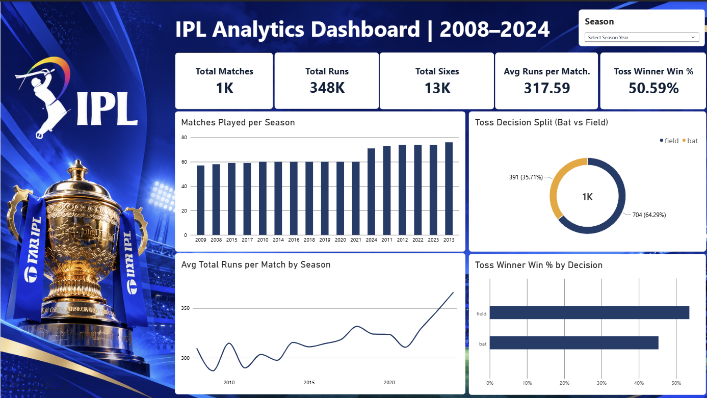
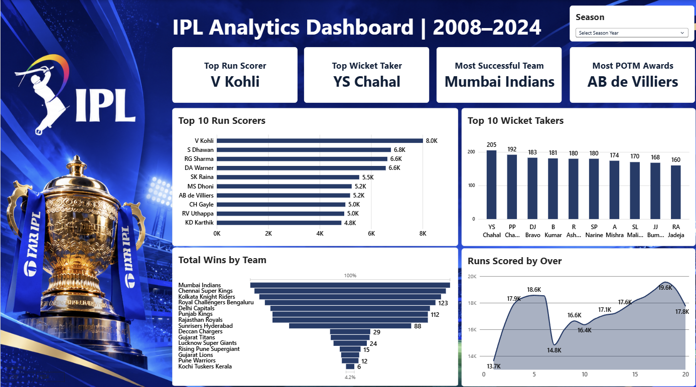

# IPL Analytics Dashboard 2008-2024 (Power BI)

An interactive two-page Power BI dashboard analysing every Indian Premier League (IPL) match from **2008 to 2024**. It covers match and scoring trends, toss impact, top batters and bowlers, team success and how runs are scored across the 20 overs. A **Season slicer** lets you filter the whole dashboard by year.

## Dashboard Preview

**Page 1: Match & Toss Overview**



**Page 2: Players & Teams**



## Objective

To explore 17 seasons of IPL data and answer questions such as: How has scoring changed over time? Does winning the toss help? Who are the standout players and teams? In which overs are most runs scored?

## Key Metrics

| Metric | Value |
|---|---|
| Total matches | ~1,095 |
| Total runs | 348K |
| Total sixes | 13K |
| Average runs per match (both innings) | 317.59 |
| Toss winner also wins the match | 50.59% |

## Key Insights

- **Scoring is rising.** Average total runs per match climbed from roughly 310 in the early seasons to around 365 in the latest season, with a sharp jump in recent years.
- **The toss gives only a small edge.** Toss winners win just 50.59% of matches, which is close to a coin flip.
- **Captains prefer to field.** Teams chose to field first in 64.29% of matches and to bat first in 35.71%.
- **Fielding first does better for toss winners.** Toss winners who chose to field won roughly 53% of their matches, compared with roughly 45% for those who chose to bat.
- **Top performers:** V Kohli is the top run scorer (about 8.0K runs) and YS Chahal is the top wicket taker (205 wickets). AB de Villiers has the most Player of the Match awards.
- **Mumbai Indians are the most successful team** by total wins, followed by Chennai Super Kings and Kolkata Knight Riders.
- **Run scoring peaks in the death overs.** Totals are highest around overs 18 to 19 and dip around over 7, just after the powerplay.
- **The league has grown.** Matches per season rose from about 58 in the early years to over 70 in recent seasons.

## Dashboard Pages

**Page 1: Match & Toss Overview**
- KPI cards: Total Matches, Total Runs, Total Sixes, Avg Runs per Match, Toss Winner Win %
- Matches played per season
- Toss decision split (bat vs field)
- Average total runs per match by season
- Toss winner win % by decision
- Season slicer

**Page 2: Players & Teams**
- KPI cards: Top Run Scorer, Top Wicket Taker, Most Successful Team, Most Player of the Match Awards
- Top 10 run scorers
- Top 10 wicket takers
- Total wins by team
- Runs scored by over
- Season slicer

## Dataset

Two CSV files are included in the `data/` folder:

- `matches.csv`: one row per match (season, city, venue, teams, toss winner and decision, winner, result margin, player of the match, umpires)
- `deliveries.csv`: one row per ball bowled (batter, bowler, runs, extras, wickets, dismissal details), about 260,000 deliveries

## Tools Used

- **Power BI Desktop**: data modelling, DAX measures, interactive visuals
- **CSV datasets**: match-level and ball-by-ball IPL data

## Repository Structure

```
IPL-Analytics-Dashboard-PowerBI/
├── README.md
├── dashboard/
│   └── IPL_Dashboard.pbix            # Power BI file (open in Power BI Desktop)
├── data/
│   ├── matches.csv
│   └── deliveries.csv
└── screenshots/
    ├── page1_match_and_toss_overview.png
    └── page2_players_and_teams.png
```

## How to Open

1. Download `dashboard/IPL_Dashboard.pbix`.
2. Open it in [Power BI Desktop](https://powerbi.microsoft.com/desktop/) (free).
3. If prompted, point the data sources to `data/matches.csv` and `data/deliveries.csv`.

## Author

**Ganesh Kurup**
BSc IT graduate | Aspiring Data Analyst
[LinkedIn](https://linkedin.com/in/ganesh-kurup-713b54433) | [GitHub](https://github.com/ganeshkurup19)
